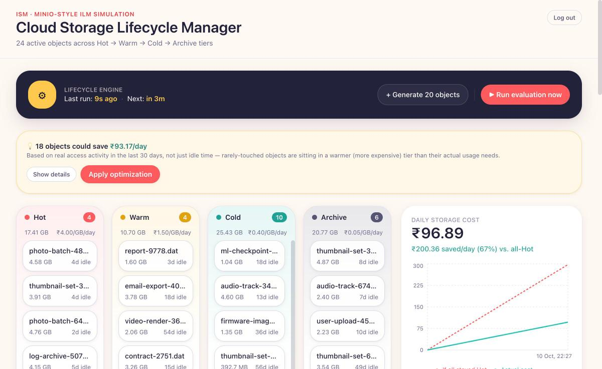
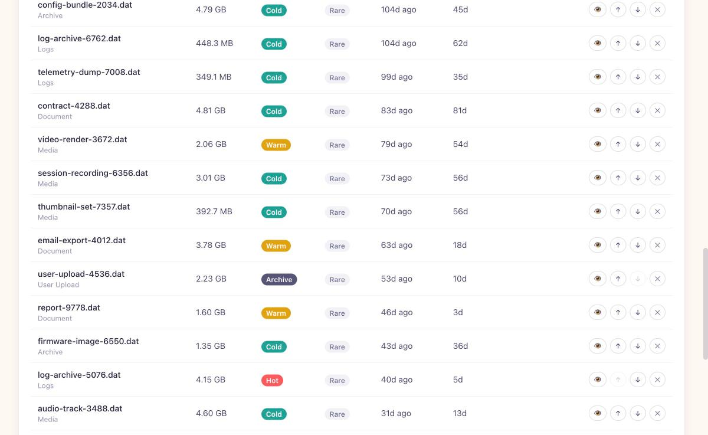
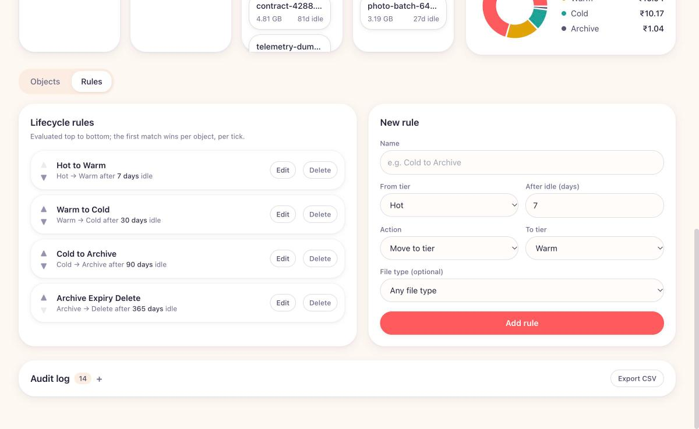

# Cloud Storage Cost and Lifecycle Manager

A college subject project for **Information Storage and Management (ISM)**. It simulates a cloud
object storage system's information lifecycle management (ILM), modeled on **MinIO's ILM engine**
and S3-compatible bucket lifecycle policies — and it's backed by a **real MinIO instance**, not
just a database simulation. Objects move automatically across storage tiers — **Hot → Warm → Cold
→ Archive** — based on configurable rules, with real-time cost tracking, a rule engine, and an
admin dashboard.


*Live dashboard: tier columns, the cost-optimization suggestion banner, and the actual-vs-all-Hot savings chart.*

<details>
<summary>More screenshots (Objects table, Rules editor)</summary>


*Objects table with file-type classification, access-frequency badges, and tier filters.*


*Lifecycle rules, including the optional file-type filter per rule.*

</details>

## Tech stack

- **Frontend:** React (Vite) + Tailwind CSS, custom "ORIGYN" theme, Recharts for charts
- **Backend:** Node.js + Express REST API (`server/app.js` holds the routing/middleware; `server/index.js`
  runs it as a persistent local process, `api/index.js` wraps the same app as a Vercel serverless function)
- **Database:** Postgres via `pg` (`server/db.js`) — works with any standard provider (Vercel Postgres,
  Neon, Supabase, Railway, or a local instance) via a single `DATABASE_URL`
- **Object storage:** [MinIO](https://min.io) — one real bucket per tier (`cslm-hot`, `cslm-warm`,
  `cslm-cold`, `cslm-archive`); every transition/promotion/demotion/delete the engine performs is
  a real `copyObject`/`removeObject` call against MinIO's S3-compatible API, so an object's tier
  in the dashboard always reflects which real bucket it currently lives in. Any S3-compatible
  endpoint works here, not just MinIO specifically — just point the `MINIO_*` env vars at it.

### What's real vs. simulated

- **Real:** bucket residency, every tier transition (copy + delete between buckets), manual
  promote/demote/delete — all go through the actual MinIO S3 API. The clock is also real: the
  lifecycle engine runs on a real background schedule (`EVALUATION_INTERVAL_MS`, default 5 minutes)
  and every rule's `condition_days` is measured against real wall-clock elapsed time, not a
  simulated day counter.
- **Simulated (optional):** the Objects tab has two modes. **"Upload a file"** stores the real
  bytes of whatever you pick (PDF, image, video, anything) in MinIO — `size_mb` is read from the
  actual file, and it can be downloaded back byte-for-byte identical, including after a real tier
  move. **"Add simulated object (custom size)"** is the original placeholder-blob mode — a
  typed-in size with no real file content — kept because it's still the easiest way to demo cost
  math for, say, a "5000 MB" object without needing an actual 5 GB file lying around. The "Generate
  N objects" seed action always uses this simulated mode, and also backdates objects'
  `created_at`/`last_accessed_at` by a random real amount, so a fresh demo instantly has objects at
  different real ages instead of everyone needing to wait days for something to transition.
- The backend runs fine **without** MinIO too — if it can't connect on startup it logs a warning
  and keeps serving from Postgres (useful if you just want the rule engine/dashboard without
  standing up object storage).

## How to run

### 1. Start Postgres and MinIO

The easiest way is via the included `docker-compose.yml`, which also defines the `server`/`client`
containers — but you can start just the infra and run the app natively with `npm run dev`:

```bash
docker compose up -d postgres minio
```

This starts Postgres on `localhost:5432` (db `cslm`, user/password `cslm`/`cslm`) and MinIO on
`localhost:9000` (S3 API) and `localhost:9001` (web console, login `minioadmin` / `minioadmin`).
Requires Docker; without it, install native Postgres and MinIO instead (e.g. via Homebrew:
`brew install postgresql@16 minio/stable/minio` — or `brew install minio` if that tap fails, min.io
has discontinued direct binary downloads) with matching credentials, or just skip MinIO — see above.

### 2. Run the app

From the project root:

```bash
npm install        # installs root, server, and client dependencies (postinstall handles server/client)
npm run dev         # runs the Express API (port 4000) and Vite dev server (port 5173) together
```

Then open **http://localhost:5173** in your browser. The Vite dev server proxies `/api/*`
requests to the Express backend, so no CORS configuration is needed in development.

To install each workspace manually instead of relying on `postinstall`:

```bash
npm install --prefix server
npm install --prefix client
```

The Postgres schema (tables + the four default lifecycle rules described below) is created
automatically on first startup — see `server/db.js`'s `ready()`. On startup, the server also
connects to MinIO and creates the four tier buckets if they don't exist yet.

### Fully containerized (server + client + Postgres + MinIO)

```bash
docker compose up --build
```

Brings up Postgres, MinIO, the API (`:4000`), and the built frontend served via nginx (`:8080`)
together, with both services' data persisted in named Docker volumes.

### Deploying to production

See **[Deploying to Vercel](#deploying-to-vercel)** below — the backend was specifically
restructured (Postgres instead of SQLite, a Vercel Cron Job instead of an in-process scheduler) so
the whole app can run there.

### Environment variables

Copy `server/.env.example` to `server/.env` and adjust as needed — the server loads it
automatically on startup via `dotenv`. All variables are optional; unset ones fall back to the
defaults below (which match the `docker-compose.yml` MinIO service).

```bash
cp server/.env.example server/.env
```

| Variable | Default | Purpose |
|---|---|---|
| `DATABASE_URL` | `postgres://localhost:5432/cslm_dev` | Postgres connection string |
| `DATABASE_SSL` | `false` | Set `true` if your Postgres provider requires SSL (most hosted ones do) |
| `MINIO_ENDPOINT` | `localhost` | MinIO/S3 host |
| `MINIO_PORT` | `9000` | MinIO/S3 API port |
| `MINIO_USE_SSL` | `false` | Set `true` for an HTTPS endpoint |
| `MINIO_ACCESS_KEY` | `minioadmin` | Access key |
| `MINIO_SECRET_KEY` | `minioadmin` | Secret key |
| `MINIO_BUCKET_PREFIX` | `cslm` | Prefix for the four tier buckets |
| `EVALUATION_INTERVAL_MS` | `300000` (5 min) | How often the local-dev background scheduler re-evaluates all objects (not used on Vercel — see below) |
| `CRON_SECRET` | *(none)* | Required in production: the bearer token Vercel Cron sends to `POST /api/cron/evaluate`. Not needed locally. |
| `NODE_ENV` | `development` | Set to `production` to switch HTTP request logging to combined (Apache-style) format |
| `ADMIN_USERNAME` | `admin` | Dashboard login username |
| `ADMIN_PASSWORD` | `admin` | Dashboard login password — **change this before any real deployment** |
| `JWT_SECRET` | *(random per restart)* | Signs login session tokens — set explicitly so sessions survive a server restart |

## Deploying to Vercel

Vercel can't run the backend as originally built — a serverless function can't keep a `setInterval`
scheduler alive between requests, and SQLite's local file would reset on every cold start. The
backend was restructured specifically to fix both:

- **Postgres instead of SQLite** (`server/db.js`, via `pg`) — any standard provider works: Vercel
  Postgres, Neon, Supabase, Railway, etc. Set `DATABASE_URL` (and `DATABASE_SSL=true` for most
  hosted providers) in the Vercel project's environment variables.
- **Vercel Cron instead of a background `setInterval`** — `api/index.js` wraps the same Express app
  (`server/app.js`) as a serverless function; `vercel.json`'s `crons` entry calls
  `POST /api/cron/evaluate` on a schedule, authenticated with `CRON_SECRET` (which Vercel sends
  automatically as `Authorization: Bearer $CRON_SECRET`) rather than the admin JWT. **Vercel's free
  Hobby plan historically limits Cron Jobs to once per day** — `vercel.json` here defaults to
  `0 0 * * *` (daily) for that reason; tighten it (e.g. `*/5 * * * *`) if you're on a paid plan that
  allows more frequent schedules. Either way, the **"Run evaluation now" button always works**
  regardless of cron frequency, since it hits the normal authenticated `/api/simulation/evaluate`
  route directly, not the cron path.
- **MinIO (or any S3-compatible store) must be reachable over the network** — a Vercel function
  can't host MinIO itself (it's a persistent server, not a request handler). Point the `MINIO_*` env
  vars at a MinIO instance you host elsewhere (Railway, a VPS, etc.) or at real AWS S3 (the `minio`
  npm SDK is S3-API compatible, so real S3 credentials work as a drop-in).

### Steps

1. Provision a Postgres database (Vercel Postgres from the project's Storage tab, or an external
   provider like Neon) and copy its connection string.
2. Make sure you have a reachable MinIO/S3 endpoint and credentials (see above).
3. In the Vercel project settings, set the environment variables from the table above —
   at minimum `DATABASE_URL`, `DATABASE_SSL=true` (for most hosted Postgres), the `MINIO_*` vars,
   `CRON_SECRET`, `JWT_SECRET`, and `ADMIN_USERNAME`/`ADMIN_PASSWORD` (don't leave these as the
   `admin`/`admin` defaults in production).
4. Deploy — Vercel picks up `vercel.json` automatically: it builds `client/` as the static site
   (`buildCommand`/`outputDirectory`), deploys `api/index.js` as a serverless function handling all
   `/api/*` routes (via the `rewrites` entry), and registers the Cron Job.
5. On first request, `api/index.js` awaits `ready()` (creates the Postgres schema + seeds the
   default rules if the tables don't exist yet) before handling anything — no separate migration
   step needed.

Local dev is unaffected by any of this — `npm run dev` still runs the Express app as a normal
persistent process (`server/index.js`) with the real `setInterval` scheduler, exactly as before;
`api/index.js` and `vercel.json` only come into play on Vercel.

## Authentication

The dashboard and every `/api/*` route (except `/api/health` and `/api/auth/login`) require a
login — this closes what was previously a real gap (anyone who could reach the API could create,
modify, or delete everything). It's a single-admin-user setup, not multi-user accounts:

1. The server hashes `ADMIN_PASSWORD` with `bcrypt` at startup.
2. `POST /api/auth/login` checks the submitted credentials and, on success, returns a signed JWT
   (`server/auth.js`), valid for 12 hours.
3. The client stores the token in `localStorage` and sends it as `Authorization: Bearer <token>`
   on every request (`client/src/api.js`).
4. `server/authMiddleware.js` rejects any request to a protected route with a missing, invalid, or
   expired token (`401`); the client treats a `401` as "session expired" and bounces back to the
   login screen automatically rather than showing a generic error.

**Change `ADMIN_USERNAME`/`ADMIN_PASSWORD` and set an explicit `JWT_SECRET`** in `server/.env`
before deploying this anywhere beyond local dev.

## The lifecycle rule engine

`server/engine/lifecycleEngine.js` is the core of the project. Each **rule** has:

- `from_tier` — the source tier the rule applies to (or `Any`)
- `condition_days` — how many real days an object must sit *unaccessed* before the rule fires
- `action` — either `transition` (move to `to_tier`) or `delete` (permanently purge)

A background scheduler (`server/scheduler.js`) runs a real-time evaluation pass on an interval
(`EVALUATION_INTERVAL_MS`, default 5 minutes) — no manual clock-advancing required. There's also a
**"Run evaluation now"** button in the dashboard, and `POST /api/simulation/evaluate`, for
triggering an evaluation on demand (useful for demos, without waiting for the interval).

On every evaluation pass, the engine:

1. Loads all rules ordered top-to-bottom (their `sort_order`).
2. For every active object, computes real elapsed days since `last_accessed_at` and walks the rule
   list, applying the **first rule whose conditions match** (mirroring MinIO/S3's "first matching
   lifecycle rule wins" semantics) — at most one rule fires per object per evaluation.
3. Applies the transition or deletion, and writes an entry to the `audit_log` table.
4. Recomputes and snapshots the current cost per tier into `cost_history`, plus a "cost if this
   object had stayed in Hot" baseline used for the savings comparison chart.

Because the scheduler runs repeatedly over real time (rather than one simulated jump), an object
idling past multiple thresholds still passes through each intermediate tier correctly across
successive runs — exactly as a real ILM cron would.

### Default seeded rules

| Rule | From | Condition | Action |
|---|---|---|---|
| Hot to Warm | Hot | 7 days unaccessed | Move to Warm |
| Warm to Cold | Warm | 30 days unaccessed | Move to Cold |
| Cold to Archive | Cold | 90 days unaccessed | Move to Archive |
| Archive Expiry Delete | Archive | 365 days unaccessed | Delete |

Rules are fully editable, reorderable, and deletable from the **Rules** tab in the UI — this maps
to editing a bucket's lifecycle configuration in MinIO/S3, where each rule is an XML/JSON policy
block evaluated in order against every object in the bucket.

## Classification and cost optimization

Beyond the fixed-threshold rule engine, three lightweight (non-ML, deterministic) classification
layers sit on top of it:

- **File-type classification** (`server/engine/classification.js`) — pattern-matches each object's
  name into a category (Logs, Backup, Media, Document, ML/Dataset, Archive, User Upload, Other).
  Rules can optionally be scoped to a file type (e.g. "delete Logs after 30 days, but keep Backups
  for a year") via the rule's `file_type` field — left unset, a rule applies to every type, same as
  today.
- **Access-frequency classification** (`server/engine/enrichment.js`) — counts each object's real
  `'access'` audit events in a rolling 30-day window and labels it Frequent (≥3), Occasional (1–2),
  or Rare (0). This is observed behavior, not a fixed admin-set timer.
- **Cost optimizer** (`server/engine/optimizer.js`, `GET /api/simulation/optimize` /
  `POST /api/simulation/optimize/apply`) — combines the two: recommends the cheapest tier that
  still fits an object's *observed* access frequency (Frequent → Hot, Occasional → Warm, Rare →
  Archive), and only ever suggests moving to a *colder*, cheaper tier. This can catch savings the
  fixed-threshold rules haven't caught yet — an object with zero real accesses doesn't have to wait
  out a 90-day idle threshold to be flagged. The dashboard surfaces this as a "💡 N objects could
  save ₹X/day" banner with a one-click **Apply optimization** action; applying it moves the
  affected objects for real (actual MinIO bucket moves) and logs each one to the audit trail with
  reason "Cost optimization (low access frequency)".

None of this is AI/ML — it's the same category of deterministic, rule-based logic as the core
engine, just with an additional observed-behavior input instead of only a fixed idle-time timer.

### Forecast, compliance templates, and cross-provider comparison

Three more additions built on top of the above:

- **Upcoming-transitions forecast** (`server/engine/forecast.js`, `GET /api/simulation/forecast`) —
  for every active object, finds the *next* rule that will apply once more idle time passes (the
  mirror image of the rule engine's "what matches right now") and reports real days remaining,
  plus a real-vs-real access *trend* (Rising/Stable/Declining — comparing the last 15 days of
  observed access activity to the 15 before that). Surfaced as a sorted "what's about to happen"
  list in the dashboard, instead of only an audit trail of what already happened.
- **Compliance rule templates** (`server/engine/ruleTemplates.js`, `GET /api/rules/templates`,
  `POST /api/rules/templates/:id/apply`) — one-click bundles of rules mapped to common real-world
  retention patterns (GDPR right-to-be-forgotten, financial/HIPAA multi-year retention, log
  retention). Applying one just creates normal, fully editable rules — there's no persistent
  "template" state afterward.
- **Cross-provider cost comparison** (`server/engine/providerRates.js`,
  `GET /api/simulation/provider-comparison`) — takes your *exact* current tier distribution (same
  objects, same sizes, same tiers) and prices it against approximate published AWS S3 / Azure Blob
  / Google Cloud Storage list rates. These are illustrative, not live pricing, and this app's own
  rates are intentionally stylized for visible demo contrast rather than tuned to match real-world
  numbers — so compare tier-to-tier *ratios*, not absolute totals, between this app and the real
  providers.

## Production-readiness notes

- **Structured logging** — `server/logger.js` timestamps and levels every server log; HTTP
  requests are logged via `morgan` (dev-format locally, combined/Apache-format when
  `NODE_ENV=production`).
- **Centralized error handling** — every async route is wrapped (`server/asyncHandler.js`) so a
  thrown error reaches Express's global error-handling middleware in `index.js` and returns a
  clean `500` instead of silently hanging the request (a real gap in naive Express 4 async route
  handlers). Unhandled promise rejections are also logged rather than crashing the process.
- **Tests** — `npm test` (inside `server/`) runs a `vitest` suite (56 tests) against a real,
  throwaway Postgres database per test file (`server/testUtils.js` creates and drops one per file,
  so parallel test files never race each other's data — see "Running the tests" below). Pure engine
  logic (cost math, rule-matching with file-type filtering, classification/optimizer heuristics) is
  unit tested directly; the auth, file upload/download, and optimizer *routes* are tested end-to-end
  with `supertest` against the real Express app (`server/app.js`, split out from `index.js`/
  `api/index.js` specifically so it can be imported without starting a server — storage/MinIO calls
  are mocked in those tests).
- **Background scheduler locally, Vercel Cron in production** — see
  [Deploying to Vercel](#deploying-to-vercel) above for why these differ.

### Running the tests

Requires a local Postgres reachable at `postgres://localhost:5432/postgres` (the test helper
connects there to create/drop each test file's throwaway database) — e.g.
`brew install postgresql@16 && brew services start postgresql@16` on macOS. Then:

```bash
cd server
npm test
```

## Cost model

Rates are hardcoded in `server/engine/costEngine.js` (₹ per GB per simulated day) and mirrored on
the client in `client/src/tierConfig.js` for display purposes:

| Tier | ₹/GB/day | Retrieval delay |
|---|---|---|
| Hot | 4.00 | instant |
| Warm | 1.50 | seconds |
| Cold | 0.40 | minutes |
| Archive | 0.05 | hours |

## Mapping to real-world storage systems

- **MinIO ILM / S3 Lifecycle Policies** — the rule engine's "from tier, N days idle, then
  transition or expire" model mirrors MinIO's bucket lifecycle rules and AWS S3's
  `Transition`/`Expiration` lifecycle actions. Unlike MinIO's own ILM (which transitions objects
  to a configured remote tier, e.g. Glacier), this project models Hot/Warm/Cold/Archive as four
  *local* MinIO buckets and does the "transition" itself via `copyObject` + `removeObject` — a
  simplification that keeps the whole tiering story runnable on one local MinIO instance.
- **Storage tiering** — Hot/Warm/Cold/Archive corresponds to S3 Standard / Infrequent Access /
  Glacier / Glacier Deep Archive-style tiers, each trading retrieval latency for lower storage
  cost.
- **Cost optimization** — the "cost if everything stayed in Hot" comparison line demonstrates the
  core business case for ILM: automatically moving cold data to cheaper tiers without manual
  intervention.
- **Storage backend module** — `server/storage.js` wraps the official `minio` npm SDK: bucket
  creation on startup, `putObject` on object creation, `copyObject`+`removeObject` for both
  rule-driven and manual tier moves, and `removeObject` for expiry/manual deletes.

## Project structure

```
cloud-storage-lifecycle-manager/
├── server/             Express app, routes, lifecycle/cost/classification/optimizer engines,
│                       Postgres (db.js), storage.js (MinIO/S3 client); app.js is the routing
│                       surface, index.js runs it as a persistent process for local dev
├── api/index.js        Wraps server/app.js as a Vercel serverless function (production)
├── client/              React (Vite) + Tailwind dashboard
├── docker-compose.yml   Postgres + MinIO + server + client, for a fully containerized run
├── vercel.json          Vercel build/routing/cron config — see "Deploying to Vercel" above
└── package.json         root scripts (concurrently runs server + client for local dev)
```

See the API route files under `server/routes/` for the full REST surface (`/api/objects`,
`/api/rules`, `/api/simulation`, `/api/audit`, `/api/auth`, plus `/api/cron/evaluate` defined
directly in `server/app.js`).
